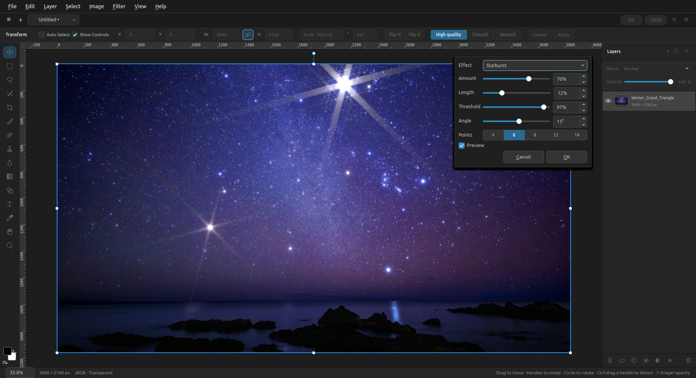
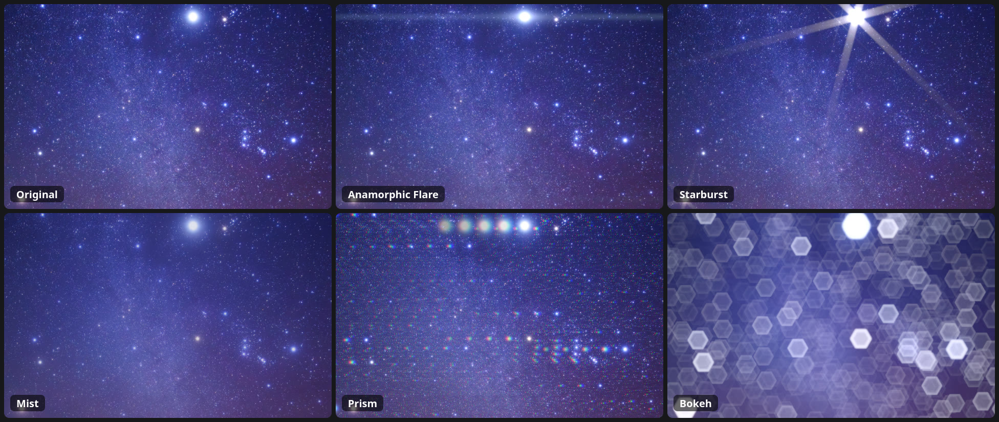
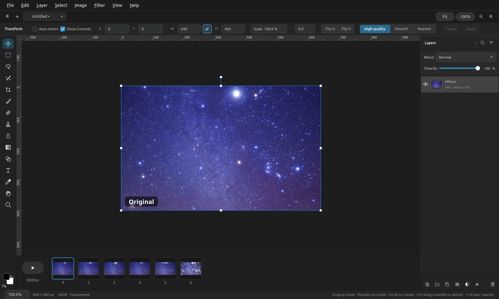

<p align="center">
  
</p>

<h1 align="center">CompositorLX</h1>

<p align="center">
  <b>A native Linux image compositor</b> with layers, masks, and Photoshop-style tools.<br>
  Qt 6 port of <a href="https://github.com/robbietilton/Compositor">Compositor</a> for macOS. Free, local, and built for compositing.
</p>

<p align="center">
  <a href="https://github.com/ClaudiuJitea/compositorLX/releases"></a>
  
  
  
  
</p>

## Requirements

| | AppImage | Debian package (`.deb`) |
| --- | --- | --- |
| **Architecture** | x86_64 | amd64 |
| **glibc** | 2.43 or newer | 2.43 or newer |
| **Tested on** | Ubuntu 26.04 | Ubuntu 26.04 |
| **Libraries** | Bundled (Qt 6.10, Poppler, LibRaw, OpenEXR, ONNX Runtime…) | From the system via `apt`: Qt 6.10, libheif, LibRaw 0.21, OpenEXR 3.1, lcms2, lensfun, Poppler Qt6, giflib, libtiff, libjpeg |
| **To run** | FUSE in the kernel (most desktops have it). Without FUSE: `--appimage-extract-and-run` | `sudo apt install ./compositorlx_0.5.8_amd64.deb` |
| **GPU (optional)** | A Vulkan 1.0 driver (tested on Intel and Mesa lavapipe; AMD and NVIDIA untested); otherwise the CPU renders everything | Same |

On distributions older than glibc 2.43, [build from source](#build-from-source).

<p align="center">
  
</p>

## Main features

- **Layers**: folders, all 24 blend modes, opacity, clipping, layer and folder masks, layer styles (stroke, shadows, glows, color overlay), and live adjustment and filter layers.
- **Non-destructive transforms**: move, scale, rotate, flip and free distort without losing source resolution, with snapping, rulers and guides.
- **Vector shapes and text**: rectangles, ellipses and styled lines, plus inline WYSIWYG text with per-letter fonts and colors.
- **Selections**: marquee, lasso, polygonal lasso, magic wand, Color Range, and content-aware fill.
- **Painting and retouching**: brush, eraser, healing, clone stamp, smudge, blur, Liquify, gradients, and pen pressure.
- **Adjustments**: Levels, Curves, Hue/Saturation, Exposure, Color Balance, Black & White, Gradient Map, and a full **Camera Raw** filter.
- **Filters**: blurs (Gaussian, Motion, Progressive), Bloom, RGB Split, Dither, Scanlines, Tonal Contrast, Vignette, Add Noise, Lens Correction, and **Lens Effects**. **Remove Background** runs a local AI model, never a web service.
- **Animated GIFs**: one layer per GIF with a frame timeline. Play, paint, duplicate, delete and retime frames, then export animated GIFs.
- **Deep color and print**: 16-bit and HDR layers (EXR, Radiance), CMYK proofing, and CMYK JPEG, TIFF and PDF export.
- **Files**: `.comp` projects interchangeable with the macOS app (versions 1–17 and 27), PSD/PSB with artboards, SVG, PDF, Camera RAW, HEIC/HEIF, WebP, PNG, JPEG and TIFF.
- **GPU rendering**: a shared Vulkan renderer for the canvas and filters, with the CPU as reference and fallback. Exports stay byte-identical on every machine. See the [GPU notes](docs/GPU_ROLLOUT.md).
- **Linux-native**: light, dark or follow-system themes, system fonts, HiDPI, Wayland support, customizable shortcuts, Search Commands (Ctrl+F), and crash-safe atomic saves.

## New in 0.5.8

Synced with macOS Compositor 1.5.8.

<p align="center">
  
</p>

- **Filter › Lens Effects**: anamorphic flare, starburst, mist, prism, and bokeh in round, hexagon, oval or cat's-eye shapes, all made from the picture's own light. Bokeh uses Vulkan compute when available.
- **GIFs play at their real speed**, on each frame's saved delay. The delay control shows the GIF's own milliseconds.
- **RGB Split**'s blur smears both ways, so the image no longer shifts.
- **Projects** in format version 27, written by builds of the macOS GIF branch, now open.

<p align="center">
  
</p>

Details and Linux differences: [port audit for 1.5.8](docs/UPSTREAM_SYNC_1.5.8.md).

## Install

Download the [AppImage or Debian package](https://github.com/ClaudiuJitea/compositorLX/releases/latest), then:

```sh
# AppImage
chmod +x CompositorLX-0.5.8-x86_64.AppImage
./CompositorLX-0.5.8-x86_64.AppImage

# Debian / Ubuntu
sudo apt install ./compositorlx_0.5.8_amd64.deb
compositor-lx
```

Verify downloads with `sha256sum --check SHA256SUMS`.

## Build from source

```sh
sudo apt install qt6-base-dev qt6-image-formats-plugins libheif-dev libraw-dev zlib1g-dev \
    libopenexr-dev libimath-dev liblcms2-dev libjpeg-dev libtiff-dev liblensfun-dev liblensfun-data-v1 \
    libpoppler-qt6-dev libgif-dev libvulkan-dev cmake ninja-build

cmake -S . -B build -G Ninja -DCMAKE_BUILD_TYPE=Release
cmake --build build
ctest --test-dir build
./build/compositor-lx [path/to/project.comp]
```

- **Vulkan is optional.** Without its headers, or with `-DCOMPOSITOR_ENABLE_VULKAN=OFF`, everything runs on the CPU.
- **Remove Background setup.** The first configure downloads a checksum-pinned ONNX Runtime and the U²-Net model.
- **Packages.** `./packaging/build-packages.sh` builds the AppImage and `.deb` into `artifacts/`.
- **Installing.** `cmake --install build --prefix "$HOME/.local"` installs into a prefix.

## Project layout

| Path | What it is |
| --- | --- |
| `src/core` | Document, history, editor commands, Camera RAW |
| `src/io` | `.comp` reader and writer, PSD, SVG, PDF, RAW and GIF import, export |
| `src/rendering` | Compositing, Vulkan renderer, layer effects, filters, subject removal |
| `src/ui` | Qt Widgets editor, canvas, panels, dialogs, shortcuts |
| `tests/` | Automated test suites, including ported macOS test expectations |
| `vendor/compositor-rendering/` | Pixel kernels shared with the macOS app |
| `docs/` | Port audits per release, project format, GPU notes |

## Version history

- **0.5.8**: macOS 1.5.8 sync. Lens Effects, GIF playback on saved delays, RGB Split smears both ways, format 27 opens.
- **0.5.6**: macOS 1.5.6 sync. GIF timeline redesign, Layers search and kind filter, Canvas Size keeps the zoom.
- **0.5.5**: GIF layers and export, PDF import, RGB Split, Channel Pack, filter layers, styled lines, pen pressure, and the shared Vulkan renderer.
- **0.5.3**: macOS 1.5.3 sync. 16-bit and HDR, CMYK, Export As, Progressive Blur, Scanlines, Last Filter, Search Commands.
- **0.4.5**: Linux polish: themes, system fonts, native dialogs, Wayland and HiDPI.
- **0.4.0**: macOS 1.4.5 sync. Per-letter text, Color Range, Dither, Grid Settings.
- **0.3.x and earlier**: Camera RAW, layer effects, vector shapes, PSD/SVG import, rulers, and inline text.

Per-release details are in [`docs/`](docs/) and on the [releases page](https://github.com/ClaudiuJitea/compositorLX/releases).

## License

MIT. CompositorLX is a Linux port of [Compositor](https://github.com/robbietilton/Compositor) by Wonder Assembly LLC. Pixel kernels under `vendor/compositor-rendering/` come from that project. ONNX Runtime and U²-Net keep their own licenses.

PDF rendering uses Poppler (GPL-2.0-or-later), and GIF encoding uses giflib (MIT). The application source is MIT-licensed. Binaries linked with Poppler are distributed under GPL-2.0-or-later. Dependency notices are in `packaging/licenses/` and in installed packages.

The screenshots use *Winter Grand Triangle* by Hajime Mizuno (mizuno-as) from the Ubuntu wallpapers, [CC BY-SA 4.0](https://creativecommons.org/licenses/by-sa/4.0/). The edited versions shown are shared under the same license.
