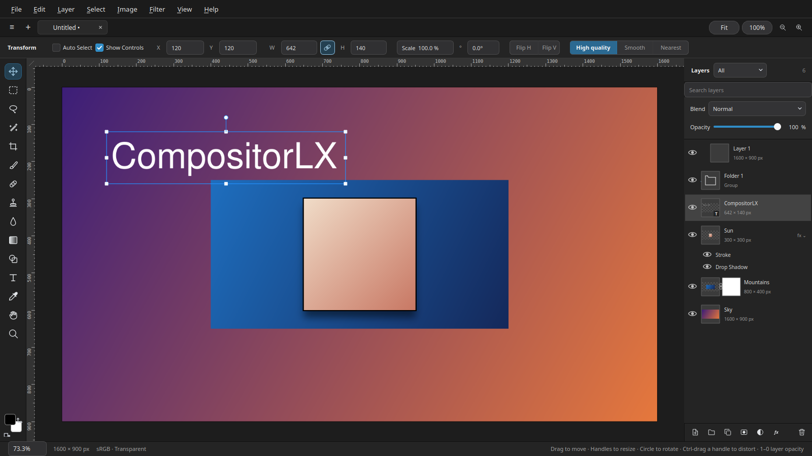
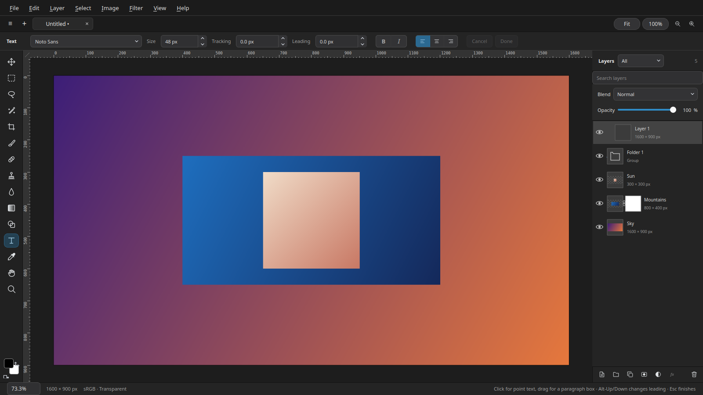

<p align="center">
  
</p>

<h1 align="center">CompositorLX</h1>

<p align="center">
  <b>A native Linux image compositor</b> with layers, masks, and Photoshop-style tools.<br>
  Qt 6 port of <a href="https://github.com/robbietilton/Compositor">Compositor</a> — free, local, and built for compositing.
</p>

<p align="center">
  <a href="https://github.com/ClaudiuJitea/compositorLX/releases"></a>
  
  
  
  
</p>

<p align="center">
  
</p>

CompositorLX is a full-featured raster editor for Linux: layered `.comp` projects (v1–v17), Camera RAW development, vector shapes, layer effects, non-destructive transforms, painting and retouching, live adjustment layers, and a local Remove Background model. No account, no cloud round-trip for subject cutouts.

## GPU acceleration — updated 0.5.5

The **0.5.5 release and its AppImage/DEB assets have been refreshed** with a shared Vulkan renderer, GPU layer compositing, more accelerated filters, hardware canvas presentation, and asynchronous Camera RAW previews. The application version remains **0.5.5**.

Choose **View › Rendering…** for Automatic, CPU, or GPU with CPU fallback, a working-memory limit, and diagnostics. Automatic keeps small or inexpensive work on the CPU. Missing drivers, unsupported operations, or memory limits retain the CPU rendering path.

GPU coverage now includes RGB Split, Gaussian/Motion/Progressive Blur, Bloom, exposure and several color adjustments, mask processing, layer-effect blur/morphology, and all 24 layer blend modes. Supported layer/filter chains keep their intermediate images on the GPU. The canvas uses Qt OpenGL where available; large Camera RAW previews run in the background and discard obsolete slider results.

On the tested Intel Iris Xe, warm 1080p renders measured **36× faster for exposure**, **26× for Hue/Saturation**, **13× for Progressive Blur**, and roughly **2–5× for the tested blur/bloom cases**, including conversion and transfers. The Camera RAW lookup was slower on the GPU, so Automatic keeps that standalone step on the CPU. These are measurements on one machine, not universal speed guarantees.

**This is a mixed CPU/GPU pipeline.** Some tools, deep-color adjustments, complex placements, codecs, and the bundled Remove Background model still use the CPU. See the [coverage matrix, benchmarks, controls, and validation notes](docs/GPU_ROLLOUT.md).

## What's new in version 0.5.5

Ports the feature additions through Compositor 1.5.5 and the subsequent GIF, layer-search, and adaptive-toolbar changes in upstream `bd76fc9`.

- **Animated GIF layers**: a frame strip with playback, frame selection, painting, duplication, deletion, original or custom delays, and a shared-delay option. Save editable animations in `.comp` projects and export composited GIFs with looping and transparency.
- **PDF import**: every page becomes a layer, at 300 DPI in a new document or fitted to the current canvas.
- **RGB Split**: linear or radial spectral dispersion with blur streaks; Split to Layers produces Red, Green, Blue, and Alpha grayscale layers.
- **Channel Pack** in Export As: select layers, groups, black, or white for each PNG channel. Color data survives even where alpha is zero.
- **Filter layers**: Progressive Blur, Bloom / Glow, and RGB Split remain editable, with masks, opacity, undo, and project round trips.
- **Lines**: solid, dotted, dashed, or long-dash patterns with square or round caps; styled lines survive project saves and scaling.
- **Pen pressure**: independent brush size and opacity controls appear after a tablet pen is used.
- **Workspace**: searchable font faces, layer name/type search, automatic two-column tools on short windows, and physical tool-key fallback for non-Latin layouts.
- **PSD artboards** open in separate tabs. Image Size and Canvas Size preserve the current zoom; new imports initially fit at no more than 100%.
- **Reliability**: corrected double-counting in the project-save pixel budget; GIF assets participate in history memory accounting and project validation.

See [the port audit and verification notes](docs/UPSTREAM_SYNC_1.5.5.md) for implementation details and platform differences.

## What's new in version 0.5.3

Brings CompositorLX up to date with the macOS app through Compositor 1.5.3, followed by a commit-by-commit parity audit.

**Deep color, HDR and print**
- **16-bit layers** stay 16-bit through painting, adjustments, filters, copy/paste and saves; Image › Layer Bit Depth converts between 8 and 16 bits.
- **HDR**: import OpenEXR and Radiance `.hdr` with highlights brighter than white kept through edits; export EXR.
- **CMYK for print**: View › CMYK proofing and gamut warning with ICC profiles, CMYK JPEG/TIFF/PDF export, and CMYK Photoshop files.
- **Export As** (Ctrl+Alt+Shift+W): JPEG, PNG, TIFF, PDF and (with an HDR layer) EXR, sized, scaled and previewed, with an opt-in 16-bit PNG. Export PNG and Export JPEG stay one step away.

**Editing**
- **Filter › Progressive Blur**, **Filter › Scanlines** as its own filter, and **Last Filter** (Ctrl+Alt+F).
- **Gaussian Blur** with Preserve Transparency and solid canvas edges; the Blur brush previews live.
- **Image › Rotate Canvas 90°** clockwise and counter-clockwise.
- **Smooth rectangle corners**; layer effects survive Image Size and scale with it; translucent Color Overlay and inner effects match Photoshop.
- Adjustments and filters remember their last settings.

**Camera Raw and RAW**
- Light, Color, Mixer, Calibration and Color Grading re-measured against Photoshop's Camera Raw; adaptive Shadows; reset each section from its header; Three-Way and single-wheel grading pages.
- RAW develop adds Noise Reduction, Highlight Recovery and Lensfun lens-profile correction, and develops at 16 bits before dithering.
- HEIF/HEIC from cameras (`.hif`) at 8–16 bits with color profiles, and WebP import.

**Workspace**
- **Search Commands** (Ctrl+F): every menu command, every tool and tool mode by name (Polygonal Lasso, Liquify, Ellipse…), ranked like a launcher.
- **Toggle Fullscreen** (F): the canvas alone on black; F or Esc brings the panels back.
- **Navigator** minimap from 300% zoom (View › Navigator); Ctrl+middle-drag zooms; middle-drag scrolls the layer list.
- New Canvas in pixels, inches, cm or mm at 72 or 300 DPI, on transparent, white or black; paste an image to make the canvas; import a folder of images; drop on the tab bar to open a new project.
- The Layers panel's adjustment-layer button sits before layer effects, as on macOS.
- Project formats v12–v14, read and written losslessly; saves include the macOS Quick Look preview.

See [the source review, verification, and remaining differences](docs/UPSTREAM_SYNC_1.5.3.md) and [project format notes](docs/project-format.md).

## What's new in version 0.4.5

A behaviour audit against the macOS app, followed by a pass to make CompositorLX feel native on Linux desktops.

**Feels at home on Linux**
- **Light, Dark or Follow System**: View › Theme. Dark is still the default; Follow System tracks the desktop's light/dark setting live (Qt 6.8+) and uses the system accent colour.
- **System fonts**: the interface uses your desktop font and size instead of a fixed typeface, and scales with it.
- **Native dialogs**: standard message boxes with the platform's button order ("Don't Save" / Cancel / Save) and dialog button rows that follow KDE and GNOME conventions.
- **Wayland friendly**: floating panels are placed by the compositor; the main window remembers its size (and position on X11).
- **HiDPI**: the canvas picks its resolution and smoothing from the real device scale, so it stays sharp at 150% and 200%; the pixel grid stays one device pixel wide; the tool rail scrolls on short screens and the minimum window size is now 760×480.
- **Desktop integration**: theme icon support, `StartupWMClass` for correct taskbar grouping, RAW and compressed-SVG file associations, richer AppStream metadata.

**Alternatives to Alt gestures** (many desktops keep Alt-drag for moving windows)
- **Hold a tool key** to use that tool for a moment; let go to return to the previous one. A quick tap still switches.
- Clone Stamp **Set Source** button, Zoom tool **Zoom In / Zoom Out** toggle, and a **From Center** checkbox for shapes and crop. Alt still works and inverts each one.
- Layer › Layer Mask › **View Mask Alone**.

**Workflow**
- **Recent projects** on the start page; opening or dropping a project's `manifest.json` opens the whole project.
- **Help menu**: Keyboard Shortcuts, Report a Problem, Check for Updates, About CompositorLX and About Qt.
- **Shortcut editor**: tooltips show each tool's key; the editor refuses keys the desktop reserves (Super combos, Ctrl+Alt+T/L/Del, Ctrl+Alt+F-keys) and keeps Ctrl+Q for Quit and Ctrl+, for Preferences.

**Behaviour fixes from the macOS audit**
- Painting refuses hidden or locked targets with a clear reason; brushes, erase, heal, blur and warp grow the layer instead of clipping at its edge.
- Live masks bake correctly on moved and scaled layers; motion blur matches the macOS result at any angle.
- Right-drag sets the brush size and hardness, Shift locks moves to an axis, the canvas auto-scrolls while dragging past its edge, Alt-drag duplicates folders, Ctrl+Shift-click adds a layer's pixels to the selection.
- Merge, flip and copy keep masks, clipping and effects in place; clipping releases correctly over sibling layers.
- Large audit-driven parity work: layer, selection, paint, text, filter, Camera Raw, PSD and IO behaviour ported from the macOS test suites (17 automated test suites).

## What's new in version 0.4.0

Brings CompositorLX up to date with the macOS app through Compositor 1.4.5.

- **Opens current macOS projects**: project format v10 and v11 (per-letter text colors and fonts) read and write losslessly; older packages stay older until a newer feature is used.
- **Per-letter text**: color and font apply to the selected letters; the font menu shows every face in its own face, previews it under the pointer, and says *(Multiple)* for mixed selections; Ctrl+Z while typing undoes typing inside the text box.
- **Select › Color Range**: click colors on the canvas (Shift adds, Alt removes), Fuzziness and Invert, with a live selection and mask preview.
- **Filter › Dither**: Atkinson, Floyd–Steinberg, Bayer 2/4/8, halftone dots/lines/diamonds, Mac patterns, ASCII and CRT scanlines.
- **Grid Settings**: spacing, subdivisions, color, style and opacity (View › Grid Settings…).
- **Layers**: Ungroup Layers (Ctrl+Shift+G); Option-click a mask thumbnail to view the mask alone; the mask button reveals the selection (Option hides it); scaled layers show their scale; Ctrl+A from the Layers panel selects the canvas.
- **Snapping**: resize handles, marquee, shapes and selection moves snap like moved layers; Shift keeps moved pixels on a straight line; Ctrl flips Auto Select and Shift flips the aspect lock, shown live in the options bar.
- **Painting tools**: Smudge without ghost trails, Liquify that keeps pixels sharp, a separate Radius for the Blur brush, and brushes that explain why they cannot paint.
- **Photoshop-accurate rendering**: Hue/Saturation positive saturation, Soft Light, Camera Raw parametric and tone curves (with a draggable point-curve graph), and PSD import fixes for levels, hue/saturation and layer masks.
- **Smaller things**: Move-bar values apply on their own as one undo step, "N more tabs" menu, New Canvas preset sizes, zoomable JPEG export preview.
- **LX suite icon**: a blue tile with stacked image layers and LX lettering, matching pdfLX's icon style.

Not ported (macOS-only): the Metal GPU canvas, Quick Look thumbnails and the Sparkle updater.

## Features

### Layers and effects
- Layers and folders with blend modes, opacity, visibility swipe, and inline rename
- **Layer styles / effects**: Stroke, Drop Shadow, Inner Shadow, Outer Glow, Inner Glow, and Color Overlay with live preview
- Layer masks you can paint, fill, invert, link, unlink, and transform on their own
- Clipping stacks and folder masks
- Merge down / selection / group, flatten, duplicate, and drag layers between project tabs

### Transform and vector shapes
- Non-destructive move, scale, rotate, and flip — source pixels keep their resolution
- **Vector shape layers**: Rectangle, Ellipse, and Line with editable fill, stroke, and corner radius
- Free-corner distortion, multi-layer and folder transforms, snapping guides
- Numeric position, size, scale, and rotation with keyboard nudging and scrubbable fields
- Flip layer or canvas, horizontally and vertically

### Selections
- Rectangular and elliptical marquee, freehand and polygonal lasso, magic wand
- Add / subtract, move the outline, or move and duplicate the pixels inside
- Load a layer’s pixels or a mask as a selection
- Content-aware fill, including extending past a layer’s edges

### Painting and retouching
- Brush and eraser with size, hardness, opacity, and Shift for straight lines
- Spot healing brush and clone stamp (aligned or not, this layer or all layers)
- Blur, gradient, and shape tools
- **Inline WYSIWYG text**: on-canvas text editing, alignment (left/center/right), bounded text boxes, and typography controls
- Eyedropper with sample ring, and a persistent color picker

<p align="center">
  
</p>

### Adjustments and Camera RAW
- **Camera RAW development**: open and develop RAW camera files (`.raw`, `.dng`, `.cr2`, `.nef`, `.arw`, etc.) with non-destructive exposure, white balance, tint, highlights, shadows, vibrance, saturation, and lens optics
- Live adjustment layers: Levels (with Auto), Curves, Hue/Saturation, Exposure, Color Balance, Brightness/Contrast, Vibrance, Black & White, Gradient Map, Selective Color, Invert, Posterize, Threshold
- Gaussian blur, motion blur, add noise, lens correction
- **Remove Background**: local ONNX + U²-Net, no web service
- Live previews, limited to the selection when one exists

### Canvas, rulers, and files
- Canvas rulers with draggable horizontal and vertical guides, snapping, and layout grid
- **Image Trim**: trim transparent borders or sample edge colors
- Multiple projects in tabs, with cross-tab layer copy and recovery
- Crop with snapping and Alt symmetry, plus Canvas Size and Image Size
- **Expanded format support**: native `.comp` (v1–v17 compatibility), Adobe Photoshop `.psd`, vector `.svg` / `.svgz`, Camera RAW, PNG, JPEG, TIFF, and HEIC/HEIF
- **Customizable keyboard shortcuts** dialog with searchable actions and desktop-conflict checks
- Light, dark and follow-system themes using the system font and accent colour
- External file change detection, conflict warning, and atomic crash-resilient saving

## Install

The 0.5.5 binaries were built on Ubuntu 26.04 and require glibc 2.43 or newer. The Debian package uses system dependencies; the AppImage bundles its other runtime libraries. Build from source for older distributions.

Download an [AppImage or Debian package](https://github.com/ClaudiuJitea/compositorLX/releases) and run:

```sh
chmod +x CompositorLX-0.5.5-x86_64.AppImage
./CompositorLX-0.5.5-x86_64.AppImage
```

Or install the `.deb` on Debian/Ubuntu:

```sh
sudo apt install ./compositorlx_0.5.5_amd64.deb
compositor-lx
```

You can also build packages locally:

```sh
./packaging/build-packages.sh
```

Finished files land in `artifacts/`. Packages include the executable, the local subject-removal runtime and model, a freedesktop launcher, AppStream metadata, a HiDPI icon set (16×16 through 1024×1024), and third-party license texts.

The editable suite icon is `packaging/icons/compositor-lx.svg`. After changing it, regenerate the packaged PNG sizes with `python3 packaging/icons/generate-icons.py` (requires CairoSVG). The SVG is also installed as the scalable desktop icon.

## Build from source

**Ubuntu / Debian**

```sh
sudo apt install qt6-base-dev qt6-image-formats-plugins libheif-dev libraw-dev zlib1g-dev \
    libopenexr-dev libimath-dev liblcms2-dev libjpeg-dev libtiff-dev liblensfun-dev liblensfun-data-v1 \
    libpoppler-qt6-dev libgif-dev libvulkan-dev cmake ninja-build
```

```sh
cmake -S . -B build -G Ninja -DCMAKE_BUILD_TYPE=Release
cmake --build build
./build/compositor-lx [path/to/project.comp]
```

Vulkan headers are optional; omit them or pass `-DCOMPOSITOR_ENABLE_VULKAN=OFF` to disable Vulkan compute. Qt OpenGLWidgets is detected separately for hardware canvas presentation. GPU rendering uses the system Vulkan loader and graphics driver at runtime. No shader compiler is needed for a normal build.

The first configure downloads checksum-pinned ONNX Runtime and the U²-Net model. Remove Background always runs on the local machine.

Install into a prefix:

```sh
cmake --install build --prefix "$HOME/.local"
```

## Project layout

| Path | What it is |
| --- | --- |
| `src/core` | Document, history, camera RAW, image trim, and editor commands |
| `src/io` | `.comp` v1–v17 reader/writer, PSD, SVG, and RAW importers, export |
| `src/rendering` | Compositing, layer effects, caches, filters, local subject removal |
| `src/ui` | Qt Widgets editor, canvas, rulers, layer effects, shortcuts, tools |
| `tests/` | Automated test suites: project format, camera raw, SVG/PSD import, layers, selections, paint, filters, text, IO and UI |
| `packaging/` | Desktop entry, AppStream metadata, icons, package script |
| `vendor/compositor-rendering/` | Shared pixel kernels from the macOS editor |
| `vendor/libraw/` | LibRaw headers for RAW digital camera photo import |

The original macOS app remains the behavior and file-format reference. Linux-specific UI and packaging live in this repository.

## Version history

- **v0.5.5**: Editable GIF layers and export, PDF import, RGB Split and channel packing, new filter layers, styled lines, pen pressure, search, adaptive tools, PSD artboards, and project formats 15–17.

- **v0.5.3**: Sync with macOS Compositor 1.5.3 (16-bit and HDR layers, CMYK proofing and export, Export As, Progressive Blur, Scanlines, Last Filter, Rotate Canvas, smooth corners, Camera Raw re-measured, RAW noise reduction and lens profiles, Search Commands, fullscreen canvas, navigator, formats v12–v14) and a commit-by-commit parity audit.
- **v0.4.5**: Native Linux polish (light/dark/system themes, system fonts, native dialogs, Wayland and HiDPI fixes, Alt-gesture alternatives, recent projects, Help menu) and macOS behaviour-parity fixes with broad test coverage.
- **v0.4.0**: Sync with macOS Compositor 1.4.5 (format v10/v11, per-letter text, Color Range, Dither, Grid Settings, painting tool fixes, Photoshop-accurate curves and saturation).
- **v0.3.1**: Fix autosave conflict dialog and recovery path handling for untitled projects.
- **v0.3.0**: Camera RAW development pipeline via LibRaw, layer effects & styles, vector shapes, PSD/SVG import, canvas rulers & guides, inline WYSIWYG text, project format v9, and automated test suite.
- **v0.2.0**: Segmented toolbar controls, improved tool options layout.
- **v0.1.0**: Initial public Linux release with local ONNX background removal, layer masks, and adjustment layers.

## License

MIT. CompositorLX is a Linux port of [Compositor](https://github.com/robbietilton/Compositor) by Wonder Assembly LLC. Pixel kernels under `vendor/compositor-rendering/` come from that project. ONNX Runtime and U²-Net keep their own license files in packaged builds.

PDF rendering uses Poppler (GPL-2.0-or-later); GIF encoding uses giflib (MIT). The application source retains its MIT license; binaries linked with Poppler are distributed under GPL-2.0-or-later. Dependency notices are included under `packaging/licenses/` and in installed packages.
