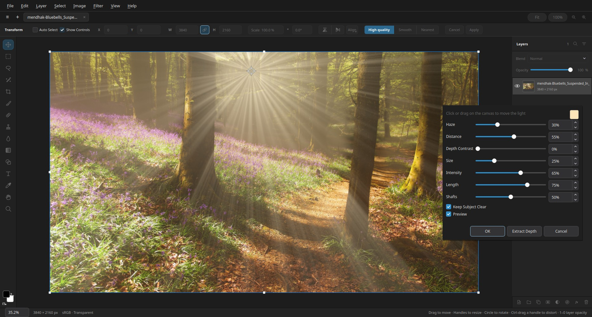
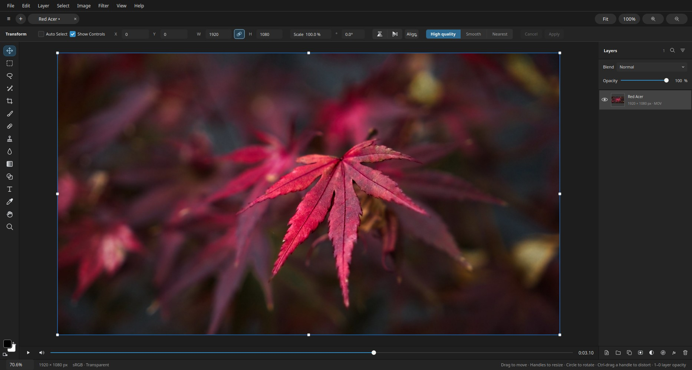
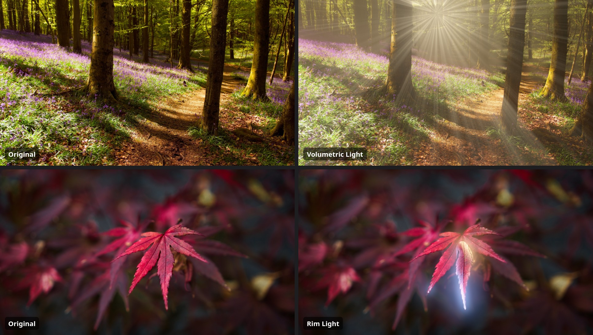

<p align="center">
  
</p>

<h1 align="center">CompositorLX</h1>

<p align="center">
  <b>A native Linux image compositor</b> with layers, masks, movies and Photoshop-style tools.<br>
  Qt 6 port of <a href="https://github.com/robbietilton/Compositor">Compositor</a> for macOS. Free, local, and built for compositing.
</p>

<p align="center">
  <a href="https://github.com/ClaudiuJitea/compositorLX/releases"></a>
  
  
  
</p>

<p align="center">
  
</p>

## What's new

**0.7.6.1: a cleaner look.**
- Slim sliders: a thin track and a small flat knob.
- Flat fields, menus and buttons, with no outlines.
- Smaller menu text without underlined letters.
- Dialogs open wide enough to show their whole title.
- Sizes in whole pixels.
- An even pair of color swatches in the tool rail.

**0.7.6: synced with macOS Compositor 1.7.6.**
- **Movie layers.** Import MOV and MP4 files, play them with sound, scrub them on the canvas, grab any frame as a still layer, and relink a moved movie. Projects link to the movie instead of copying it.
- **Softer brushes** at low hardness.
- **A compact GIF timeline** with a frame scrubber.
- **Solid toolbar pills** and clearer project tabs.

<p align="center">
  
</p>

## Features

- **Layers**: folders, 24 blend modes, clipping, layer and folder masks, layer styles, live adjustment and filter layers, Align and Distribute.
- **Transforms**: non-destructive move, scale, rotate, flip and distort, with snapping, rulers, guides and on-canvas distances.
- **Shapes and text**: editable rectangles, ellipses and lines, and inline text with per-letter fonts and colors.
- **Selections**: marquee, lasso, magic wand, Color Range and content-aware fill.
- **Painting**: brush and pencil, eraser, healing, clone, smudge, blur, Liquify, gradients and pen pressure.
- **Adjustments and filters**: Levels, Curves, Hue/Saturation, a full Camera Raw filter, blurs, Sharpen, Reduce Noise, Lens Effects, **Rim Light**, **Volumetric Light** and more, most as adjustment layers. **Remove Background** and depth run on local AI models.
- **GIFs and movies**: animated GIF layers with a frame timeline and GIF export. MOV/MP4 movie layers with playback and scrubbing.
- **Files**: `.comp` projects shared with the macOS app, PSD import and layered PSD export, SVG, PDF, Camera RAW, HEIC, WebP, EXR, PNG, JPEG and TIFF. 16-bit, HDR and CMYK.
- **Fast**: a Vulkan renderer for the canvas and filters, with every CPU core as fallback ([GPU notes](docs/GPU_ROLLOUT.md)).
- **Linux-native**: dark, light or system theme, HiDPI, Wayland, custom shortcuts and Search Commands (Ctrl+F).

<p align="center">
  
</p>

## Install

Download the [AppImage or Debian package](https://github.com/ClaudiuJitea/compositorLX/releases/latest). Both need glibc 2.43 or newer (Ubuntu 26.04).

```sh
# AppImage: everything bundled
chmod +x CompositorLX-0.7.6.1-x86_64.AppImage
./CompositorLX-0.7.6.1-x86_64.AppImage

# Debian / Ubuntu: use apt, which installs the libraries it needs (dpkg -i doesn't)
sudo apt install ./compositorlx_0.7.6.1_amd64.deb
```

A Vulkan driver is optional; without one the CPU renders everything. Verify downloads with `sha256sum --check SHA256SUMS`.

## Build from source

```sh
sudo apt install qt6-base-dev qt6-image-formats-plugins qt6-multimedia-dev libheif-dev libraw-dev zlib1g-dev \
    libopenexr-dev libimath-dev liblcms2-dev libjpeg-dev libtiff-dev liblensfun-dev liblensfun-data-v1 \
    libpoppler-qt6-dev libgif-dev libvulkan-dev libavformat-dev libavcodec-dev libswscale-dev cmake ninja-build

cmake -S . -B build -G Ninja -DCMAKE_BUILD_TYPE=Release
cmake --build build
ctest --test-dir build
./build/compositor-lx
```

The first configure downloads a checksum-pinned ONNX Runtime and the U²-Net model. `./packaging/build-packages.sh` builds the AppImage and `.deb`.

## Version history

- **0.7.6.1**: UI polish: slim sliders, flat controls, smaller menus, dialogs sized to their titles.
- **0.7.6**: macOS 1.7.6 sync. Movie layers, softer brushes, compact GIF timeline ([details](docs/UPSTREAM_SYNC_1.7.6.md)).
- **0.7.0–0.7.2**: macOS 1.7.0 sync. Sharpen, Reduce Noise, Rim Light, Volumetric Light, editable shapes, Align and Distribute, PSD export ([details](docs/UPSTREAM_SYNC_1.7.0.md)).
- **0.5.x**: Lens Effects, GIF layers, PDF import, 16-bit and HDR, CMYK, the Vulkan renderer.
- **0.4.x and earlier**: themes and Wayland, per-letter text, Camera RAW, layer effects, PSD/SVG import.

All releases: [releases page](https://github.com/ClaudiuJitea/compositorLX/releases).

## License

MIT. CompositorLX is a Linux port of [Compositor](https://github.com/robbietilton/Compositor) by Wonder Assembly LLC, whose pixel kernels are in `vendor/compositor-rendering/`. PDF rendering uses Poppler (GPL-2.0-or-later), so binaries linked with it are distributed under GPL-2.0-or-later; giflib, FFmpeg, ONNX Runtime and U²-Net keep their own licenses (notices in `packaging/licenses/`).

Screenshots: *Bluebells Suspended In Time* and *Red Acer* by mendhak from the Ubuntu wallpapers ([CC BY-SA 4.0](https://creativecommons.org/licenses/by-sa/4.0/)). The edited versions and the movie made from *Red Acer* are shared under the same license. The editor renders them itself with `tools/ReadmeShots.cpp`.
